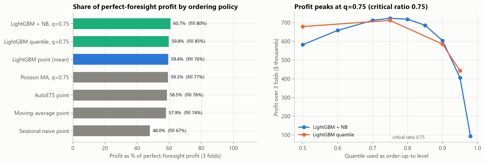
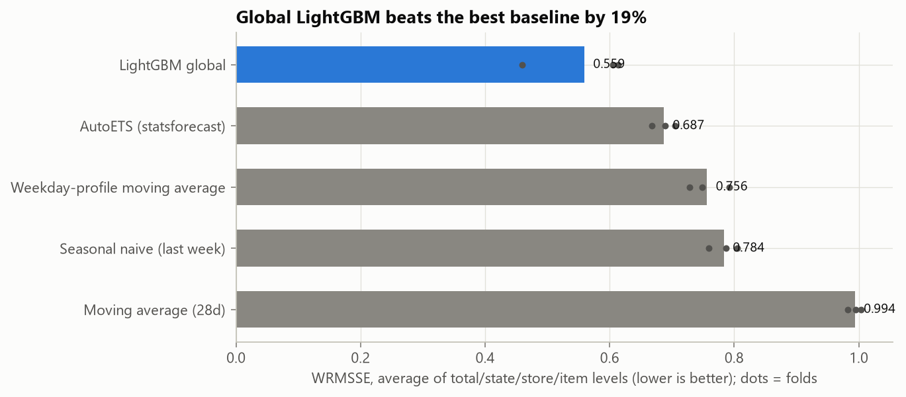
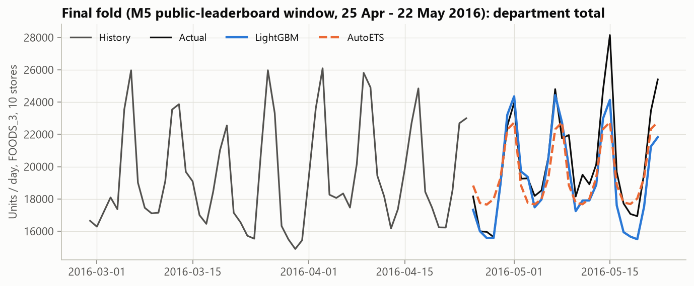
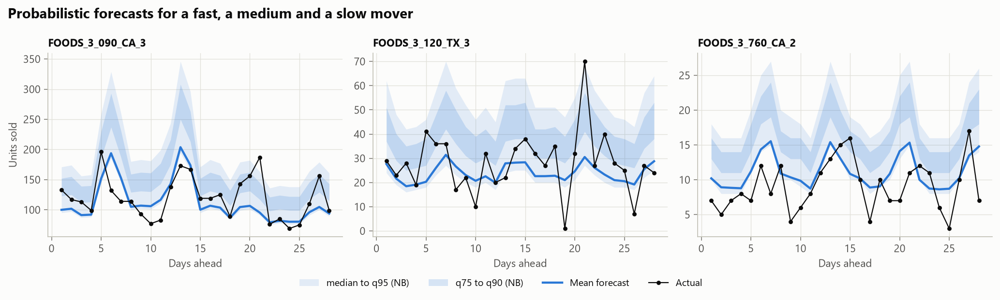
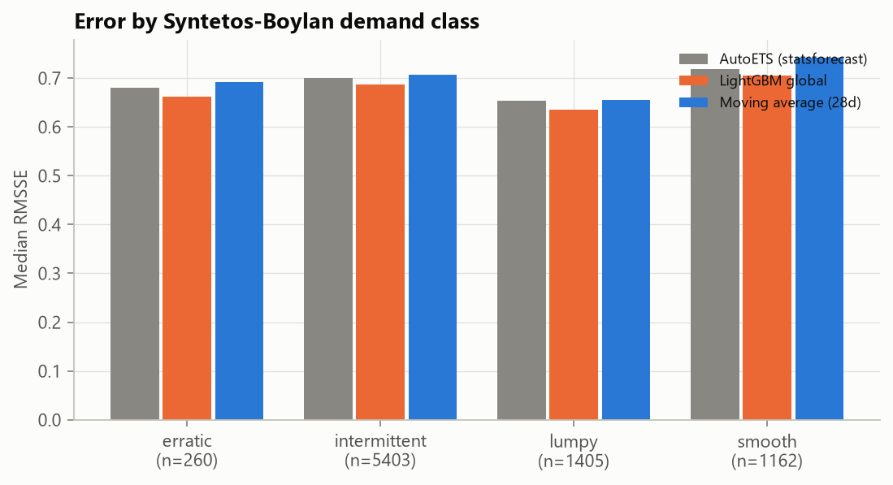

# How much should each store order? Probabilistic demand forecasting and inventory decisions on Walmart M5

  

A point forecast answers "how many will we sell?". A store manager needs the answer to a different question: "how many should I stock, given that running out loses a sale and leftovers cost money?". This project forecasts daily demand for the 8,230 item-store series in Walmart's largest food department (M5 competition data, `FOODS_3`, 10 stores in California, Texas and Wisconsin), produces full predictive distributions, and replays an inventory policy against what actually sold to measure the profit each forecast earns.

**The short version:**
- A single global LightGBM model beats per-series exponential smoothing (AutoETS), the strongest baseline, by **19% on WRMSSE** (0.559 vs 0.687, M5's official metric). It wins on every fold, at every level of the store hierarchy, and in every intermittency class.
- Ordering to the **75th percentile** of each item's forecast distribution, the newsvendor critical ratio for a 30% margin and 10% daily holding cost, earns **60.7%** of perfect-foresight profit. That is 2.3% more than ordering to the same model's mean forecast, 3.7% more than AutoETS and 26.6% more than "last week's sales". The profit curve over order quantiles peaks exactly at the critical ratio, as theory predicts.
- Getting there required finding and fixing a **10% under-forecast** in the first version of the model, caused by a common M5 feature design.



## Data and backtest design

- **Data:** [M5 Forecasting Accuracy](https://zenodo.org/records/12636070) (Walmart via the University of Nicosia, CC-BY-4.0). Daily unit sales from January 2011 to June 2016, weekly sell prices, calendar events and SNAP benefit days.
- **Scope:** `FOODS_3`, 823 items × 10 stores = 8,230 series. Half of all item-days are zero sales, so intermittent demand is the norm.
- **Rolling-origin backtest:** three consecutive 28-day windows. Every model is refit at each origin on the 730 days before it, and the last window is M5's public-leaderboard (validation) period, d_1914–d_1941. The actuals for M5's final evaluation window (d_1942–d_1969) are not in the released sales file, so it cannot be scored.

| Fold | Training data ends | Forecast window |
|---|---|---|
| 1 | d_1857 | d_1858–d_1885 (29 Feb – 27 Mar 2016) |
| 2 | d_1885 | d_1886–d_1913 (28 Mar – 24 Apr 2016) |
| 3 | d_1913 | d_1914–d_1941 (25 Apr – 22 May 2016), M5's public-leaderboard window |

## Models

| Model | What it is |
|---|---|
| Seasonal naive | Repeat the last observed week |
| 28-day moving average | Flat forecast at the recent mean |
| Weekday-profile moving average | 8-week level × a shrunken day-of-week profile |
| AutoETS | Per-series exponential smoothing with weekly seasonality (statsforecast), the classic M5 benchmark family |
| **Global LightGBM** | One model across all 8,230 series with lag, rolling-window, price, calendar and SNAP features, horizon-aware and trained on a scale-free target (below) |

Probabilistic forecasts:
- **Poisson** around the 28-day moving average (baseline);
- **Negative binomial** around the LightGBM mean, with dispersion estimated per series from its last 112 days;
- **LightGBM quantile regression** at 0.50, 0.75, 0.90 and 0.95.

### What it took to make the global model beat the baselines

The first version followed a common M5 recipe: every feature lagged at least 28 days, so one model can forecast the whole window without recursion. On fold 1 it lost to AutoETS (WRMSSE 0.82 vs 0.69) because it forecast **10% too little in total**. Diagnosing that bias took three experiments on a 1,500-series subset across two origins:

| Change | Total bias (fold 1) | Why |
|---|---|---|
| Baseline: all features lagged 28+ days | −10.9% | The model never sees the last four weeks, so it misses the spring ramp-up that a simple 28-day average catches (−2%) |
| Horizon-aware features | −8.4% | Each training row gets a random horizon h in 1–28 and sees data up to d − h; at forecast time day 1 uses yesterday's sales |
| + scale-free target (demand ÷ recent 28-day level, level-weighted L2) | **−4.0%** | The model learns relative patterns that survive level shifts; also lowest error on the fold-3 window |

Recency weighting, a one-year training window, Poisson loss and store-level momentum features were also tested and rejected. [`scripts/bias_experiments.py`](scripts/bias_experiments.py) reruns the comparison (about 5 minutes).

## Metrics

- **WRMSSE** (M5's official metric): RMSE scaled by each series' in-sample naive error, weighted by recent dollar sales. Reported at four levels (total, state, store, item-store) and averaged. The M5 competition used 12 levels; four keep the hierarchy's main levels.
- **Scaled pinball loss** and **empirical coverage** for the quantiles.
- **Inventory replay:** each morning the store tops stock up to a target S (zero lead time); unmet demand is lost; leftovers carry over and cost 10% of the price per unit per day (capital, space, spoilage). Gross margin is 30%. The newsvendor critical ratio 0.30 / (0.30 + 0.10) = 0.75 says the profit-maximising target is the 75th percentile of demand, which is why the quantiles matter more than the mean.

## Results

### Point accuracy



| Model | WRMSSE (avg of 4 levels) | Total | State | Store | Item-store | Total bias |
|---|---|---|---|---|---|---|
| **Global LightGBM** | **0.559** | **0.407** | **0.450** | **0.558** | **0.823** | −2.3% |
| AutoETS | 0.687 | 0.577 | 0.626 | 0.684 | 0.861 | −0.8% |
| Weekday-profile moving average | 0.756 | 0.696 | 0.708 | 0.764 | 0.857 | −3.7% |
| Seasonal naive | 0.784 | 0.608 | 0.679 | 0.772 | 1.076 | −4.8% |
| 28-day moving average | 0.994 | 1.054 | 1.022 | 1.019 | 0.881 | −1.8% |

| Fold | LightGBM | AutoETS |
|---|---|---|
| 1 (29 Feb – 27 Mar) | 0.614 | 0.689 |
| 2 (28 Mar – 24 Apr) | 0.459 | 0.705 |
| 3 (25 Apr – 22 May, M5 public leaderboard window) | 0.605 | 0.668 |

The largest gains are at the aggregate levels (total and state), which matter for distribution-centre and truck planning. LightGBM also has the lowest median RMSSE in all four Syntetos-Boylan demand classes (smooth, erratic, intermittent, lumpy).



### Probabilistic accuracy

| Method | Coverage at q = 0.75 | q = 0.90 | q = 0.95 | Scaled pinball at q = 0.75 |
|---|---|---|---|---|
| LightGBM quantile regression | **74.6%** | 88.5% | 93.8% | 0.465 |
| Negative binomial around the LightGBM mean | 80.8% | 92.9% | 96.3% | 0.465 |
| Poisson around the 28-day average | 80.6% | 88.7% | 91.7% | 0.478 |

Direct quantile regression is the best calibrated. The negative-binomial version over-covers slightly, yet earns the most profit in the replay (below): because unsold stock carries over to the next day, erring a little high costs less than the newsvendor's single-period assumption implies.



### The inventory decision

| Ordering policy (3 folds, 8,230 item-stores, 84 days) | Profit | Share of perfect foresight | Fill rate | Avg units on hand |
|---|---|---|---|---|
| Perfect foresight | $1,190,640 | 100% | 100% | 0.0 |
| **LightGBM + negative binomial, q = 0.75** | **$723,186** | **60.7%** | 80% | 3.9 |
| LightGBM quantile model, q = 0.75 | $711,614 | 59.8% | 85% | 5.1 |
| LightGBM mean forecast | $706,941 | 59.4% | 76% | 3.3 |
| Poisson around 28-day average, q = 0.75 | $705,539 | 59.3% | 77% | 3.6 |
| AutoETS mean forecast | $697,082 | 58.5% | 76% | 3.4 |
| 28-day moving average | $689,949 | 57.9% | 74% | 3.2 |
| Seasonal naive | $571,197 | 48.0% | 67% | 3.8 |

Scaled to a year, the best policy is worth about **$70k more than ordering to the mean of the same model** and about **$113k more than an AutoETS-based process**, for one department across ten stores, under the stated margin and holding-cost assumptions.

The forecast's *shape* matters as much as its *accuracy*. Swapping AutoETS for LightGBM (better point forecast, same ordering rule) adds 0.9 points of perfect-foresight profit. Switching from the mean to the critical-ratio quantile (same model) adds another 1.3 points.



## Limitations

- **Sales are censored demand.** When a shelf was empty, M5 records what sold, not what customers wanted, so lost sales in the replay are a lower bound.
- **Zero lead time and daily review.** Real replenishment has lead times and order minimums; the replay isolates the forecasting question.
- **Costs are assumptions** (30% margin, 10% daily holding). Both live in [`config.py`](src/demand_forecasting/config.py), and the service-level curve shows how the best quantile moves with them.

## Reproduce

```bash
python -m venv .venv && source .venv/bin/activate     # Windows: .venv\Scripts\activate
pip install -r requirements.txt
python scripts/download_data.py      # ~48 MB zip from Zenodo
python scripts/run_pipeline.py       # ~75 min on a 6-core laptop; fits are cached per fold, so re-runs take ~1 min
pytest -q
```

## Repository structure

```
src/demand_forecasting/
  config.py      scope, backtest origins, inventory economics
  data.py        M5 -> dense (series x day) sales and price matrices, cached
  features.py    vectorised, leak-free features; horizon-aware mode
  models.py      baselines, AutoETS, global LightGBM (scale-free target), negative-binomial quantiles
  metrics.py     RMSSE / WRMSSE, scaled pinball, coverage, Syntetos-Boylan demand classes
  inventory.py   order-up-to replay with lost sales and holding cost
scripts/         download_data.py, run_pipeline.py
tests/           leakage tests (features unchanged when the future is overwritten), metric and replay tests
reports/         figures/, tables/, RESULTS.md, metrics.json
```

## References

- Makridakis, S., Spiliotis, E. & Assimakopoulos, V. (2022). *M5 accuracy competition: Results, findings, and conclusions.* International Journal of Forecasting.
- Syntetos, A. & Boylan, J. (2005). *The accuracy of intermittent demand estimates.* International Journal of Forecasting.
